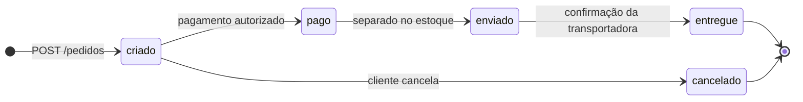
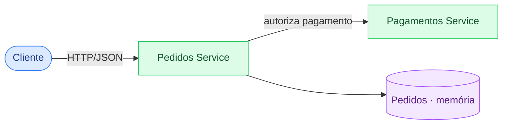

# Arquitetura

## Ciclo de vida do pedido

*Figura 1 · Status possíveis de um pedido e o que dispara cada transição.*

## Dependências

*Figura 2 · O Pedidos Service depende do Pagamentos Service para autorizar o pagamento.*

!!! warning "PoC"
    O armazenamento é em memória e os pedidos se perdem a cada restart.
